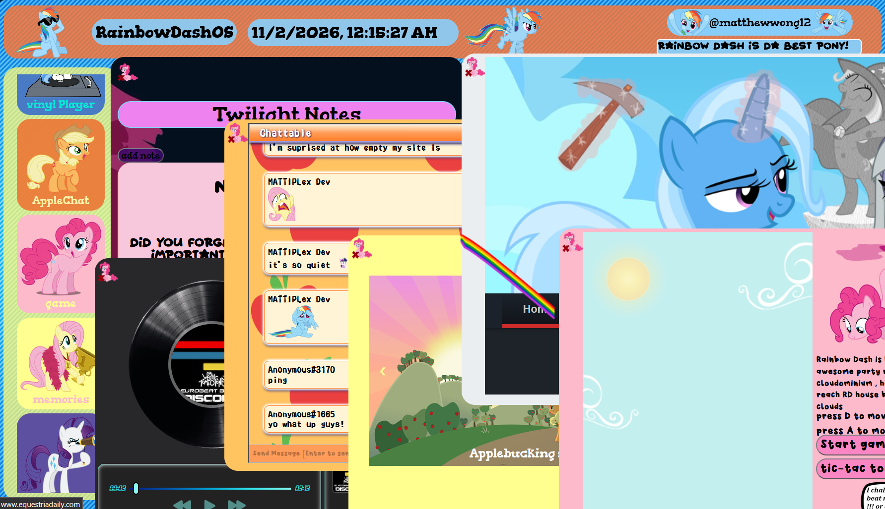

# Rainbow-dash-OS
MLP Theme WebOS

## A MLP browser for the brony by a brony.The Cutest and Coolest OS around.

well best check it out yourself   
https://mattiplex.github.io/Rainbow-dash-OS/

# a short introduction   
sry for the terrible video quality , Github only allow 10Mb max for video

https://github.com/user-attachments/assets/ad7a8c0d-9ca4-480b-988c-232efc658919    

# Main Features   

* a Welcome Screen
* a notes app
* a Music app
* a global chat
* a game
* a gallery
* and news site
* lots of Ponies
* Element Of Harmony
* Friendship Is Magic

## some tools that i think very useful    
1.ishimori (website)  
2.scripted resources (website)  
3.MlP Vector Club (website)  
4.Mf2fm (website)

